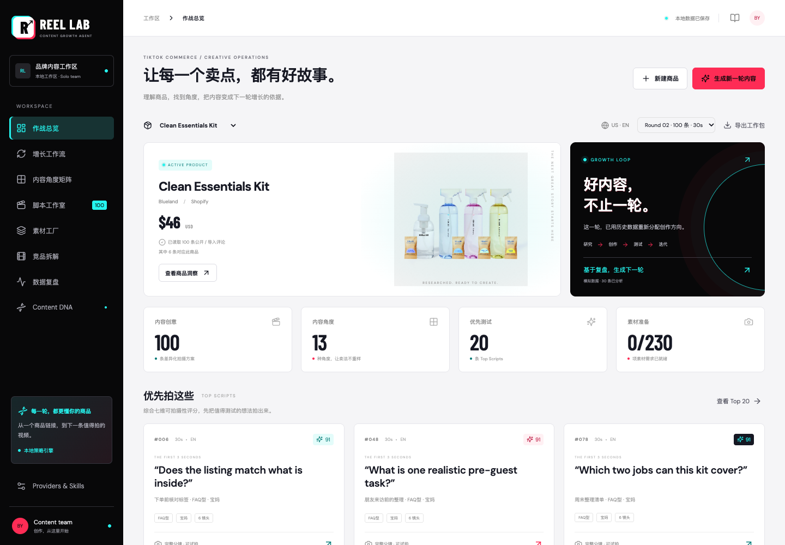
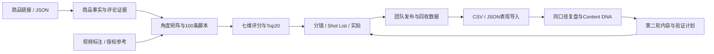
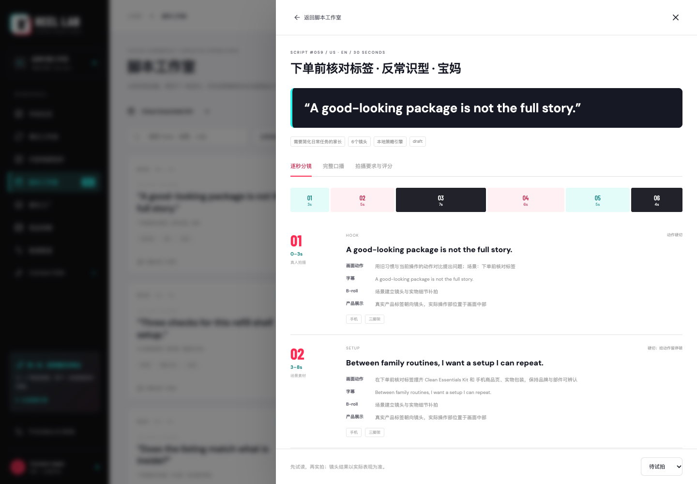

<div align="center">

# REEL LAB · TikTok 内容增长智能体

**一个商品链接，生成 100 条可拍脚本；导入表现数据，让下一轮创作有据可依。**

商品理解 · 内容拆解 · 批量脚本 · 逐秒分镜 · 素材规划 · Content DNA · 数据迭代

[](https://nodejs.org/)
[](https://www.typescriptlang.org/)
[](https://react.dev/)
[](LICENSE)

**作者：越哥｜全网同名：越哥聊AI**

[快速开始](#快速开始) · [使用说明](docs/case-assets/使用说明.md) · [标准案例](docs/case-assets/README.md) · [输出示例](docs/case-assets/输出示例.md) · [许可证与授权](#许可证与授权)

</div>

> **授权要求：所有使用均须事先获得作者越哥的明确书面授权，包括个人、学习、研究、测试、非商业和商业用途。** 请通过全网同名“越哥聊AI”的官方账号联系作者。完整条款见 [LICENSE](LICENSE)。



## 项目定位

REEL LAB 面向 TikTok Shop 卖家、跨境品牌、DTC 独立站、MCN 和内容团队，将商品资料、评论证据、视频参考结构、脚本、分镜、素材任务和复盘结果放进同一个商品工作区。

重点是交付可以试读、实拍、测试与复用的内容：每条方案都有目标用户、前三秒 Hook、完整口播、逐镜头动作、字幕、素材需求和 CTA。发布后导入视频表现，系统提取品牌自己的 Content DNA，调整下一批的创作方向。

**当前版本：本机单团队 V1。** 无模型密钥即可通过本地策略引擎跑通 Demo；可选接入兼容 OpenAI Chat Completions 的模型与授权数据网关。自动视频生成、TTS、数字人、剪辑和发布尚未实现。

## 核心能力

| 模块 | 当前可用能力 | 交付物 |
| --- | --- | --- |
| 商品理解 | 公开 Product JSON-LD、Shopify 商品 JSON、用户导入；记录价格、规格、卖点、图片、视频、FAQ 与缺口 | 带来源的商品档案 |
| 评论挖掘 | 方面情感关键词分析、原句证据；区分当前 SKU 与关联商品 | 痛点与购买异议线索 |
| 参考视频拆解 | 导入带时间戳的镜头标注 / 转录，或通过授权 Provider 解析 URL | Hook、镜头节奏、字幕、卖点顺序、情绪、CTA、Content Pattern |
| 内容角度矩阵 | 13 类角度、4 类人设，Demo 包含 12 个场景；批次内和历史完整组合去重 | 100 条结构化候选方案 |
| 脚本与分镜 | 15 / 30 / 60 秒；口播、画面动作、字幕、B-roll、产品展示、转场、设备、音乐建议 | 可试拍的脚本工作包 |
| UGC Creator | 大学生、宝妈、健身达人、专业测评博主；Top10 换人设并保留父脚本关系 | 人设脚本与拍摄要求 |
| 可拍摄性评分 | Hook、信息密度、拍摄易度、素材成本、产品清晰度、差异化、平台适配 | Top20 优先试拍清单 |
| 素材工厂 | 合并可复用镜头需求，管理负责人、素材链接、状态和使用权 | Shot List、拍摄任务与素材缺口 |
| 数据复盘 | CSV / JSON 导入、整批校验、幂等更新；按来源、市场、语言和币种分组 | 留存、完播、观看时长、CTR、CVR、GMV、ROAS |
| Content DNA | Hook 类型、结构、时长、镜头数、卖点、CTA、人设、场景等标签 | 高表现方向与样本依据 |
| 迭代与实验 | 约 70% 候选参考已观察方向、30% 探索新组合；保留分析与批次关联 | 第二轮内容与待执行验证计划 |
| 工作流与导出 | 六阶段产物状态、批次沿革、真实任务状态；Markdown / CSV / JSON 导出 | 可回查、可交接的完整流程 |

内容角度覆盖：**痛点、效果展示、前后对比、测评、开箱、教程、场景、用户故事、价格价值、反常识、FAQ、挑战、UGC 口碑**。

评分属于规则判断，DNA 结论属于观察关联，均不代表爆款概率或收益预测。

## 增长工作流



统一数据模型包括 `Product`、`Audience`、`ContentAngle`、`Script`、`Storyboard`、`Shot`、`CreatorPersona`、`MaterialAsset`、`PublishedVideo`、`PerformanceMetric`、`ContentPattern`、`Experiment`，并通过 `Batch`、`Analysis`、`Evidence`、`Job` 记录关系与来源。详见 [类型定义](shared/types.ts) 和 [API 文档](docs/API.md)。

## 快速开始

以下安装、运行、测试和案例复演步骤面向已获得相应书面授权的使用者。

### 1. 获取项目

需要 **Node.js 22.13+、npm 和 Git**。浏览器端到端测试与案例截图另外需要本机 Google Chrome。

```bash
git clone git@github.com:bingyue/tiktok-growth-studio.git
cd tiktok-growth-studio
npm ci
```

没有配置 GitHub SSH 时，也可使用：

```bash
git clone https://github.com/bingyue/tiktok-growth-studio.git
```

### 2. 载入 Demo 并启动

```bash
npm run demo
npm run dev
```

打开 [内容作战室](http://127.0.0.1:4348/)。`npm run demo` 使用带来源和抓取时间的公开商品快照，生成两轮各 100 条内容，并导入 30 条**模拟**历史表现。商品图片仍需要联网读取。

重新从真实商品链接研究：

```bash
npm run demo -- --live
```

每次 Demo 都新建独立商品工作区，不覆盖原有商品。界面内可在“增长工作流”选择“从真实链接运行 Demo”或“用来源快照演示”。也可不运行 Demo，直接启动后点击“新建商品”。

### 3. 构建后本机运行

```bash
npm run build
npm start
```

默认端口 `4348`，只监听 `127.0.0.1`。构建后仍需要 Node.js 服务和 SQLite；仅上传 `dist/` 无法运行完整应用。

## 五分钟上手

1. **研究商品**：点击“新建商品”，输入商品链接或导入 JSON；在“查看商品洞察”核对卖点、评论归属和证据。
2. **补充参考**：进入“竞品拆解”，导入有权使用的镜头标注 / 转录；平台 URL 解析需已配置的授权 Provider。
3. **生成内容**：选择数量、时长、市场、语言、人设和生产方式，生成第一轮；通过矩阵比较不同拍法。
4. **挑选试拍**：打开 Top20，检查口播、逐秒分镜与评分；在“素材工厂”分配负责人并导出 Shot List。
5. **复盘迭代**：导入视频表现，选择数据组，点击“复盘最近30条”，再点击“生成下一轮100条”。

完整操作、输入模板、故障排查和注意事项见 [使用说明](docs/case-assets/使用说明.md)。

### 自然语言指令

| 输入示例 | 实际行为 |
| --- | --- |
| 给这个商品生成100条美国市场英文脚本 | 新建 100 条批次；未指定的时长沿用当前批次 |
| 只做15秒UGC | 默认生成 20 条 15 秒 UGC 方案 |
| 把Top10改成宝妈人设 | 改写当前批次 Top10，并保留父脚本关系 |
| 根据最近30条视频数据重新生成下一批 | 使用当前商品、市场和语言最近保存的复盘；请先在复盘页运行“复盘最近30条” |

当前采用有限类型的命令解析。“最近30条”指视频条数，不是最近30天。复杂自由对话需要进一步扩展。

### 一条脚本包含什么

目标用户 / 内容角度 / 3 秒 Hook / 完整口播 / 镜头起止时间 / 画面动作 / 字幕 / B-roll / 产品展示方式 / 转场与设备 / 音乐建议 / CTA / 总时长 / 评分与拍摄要求。



[单条完整输出示例](docs/case-assets/输出示例.md) · [首轮 Top20](docs/case-assets/outputs/round-1-top20.md) · [第二轮 Top20](docs/case-assets/outputs/round-2-top20.md)

## 模型与数据 Provider

复制配置模板，填写需要接入的能力，然后重启服务：

```bash
cp .env.example .env
```

| 配置项 | 用途 | 是否必需 |
| --- | --- | --- |
| `PORT` | HTTP 端口，默认 `4348` | 否 |
| `DATA_DIR` | SQLite 数据目录，默认 `./data` | 否 |
| `AI_BASE_URL` | 兼容 Chat Completions 的 API 根地址 | 模型模式按服务商填写 |
| `AI_API_KEY` | 文本模型密钥 | 模型模式需要 |
| `AI_MODEL` | 模型名称 | 模型模式需要 |
| `DATA_PROVIDER_URL` | 自有或授权数据网关根地址 | 授权数据模式需要 |
| `DATA_PROVIDER_TOKEN` | 网关 Bearer 凭证 | 按网关要求填写 |

无密钥时可使用“本地策略引擎”。接入模型后，在生成弹窗选择“兼容模型”；响应会进行结构与时长校验。超时或不合格时任务失败，整批不落库，不会悄悄退回模板。

支持 US / UK / DE / JP 市场选项。清洁套装 Demo 本地模板提供英文、中文、西班牙语、德语和日语；其他商品的通用本地模板只支持中英文，更多语言需要模型。市场与人群画像是创作假设，正式投放前应进行当地语言和文化审核。

TikTok Shop 和 Amazon 页面受限时，使用官方授权数据源、用户导入或自有网关。项目未内置已授权的 TikTok 官方 API 连接。视频生成、TTS、Avatar、自动剪辑仅预留可替换接口。详见 [Provider 接入协议](docs/PROVIDERS.md)。

## 数据导入与口径

- 商品资料示例：[product-import.json](docs/case-assets/examples/product-import.json)。
- 视频参考标注示例：[reference-annotation.json](docs/case-assets/examples/reference-annotation.json)。
- 无脚本依赖的模拟表现示例：[performance-synthetic.json](docs/case-assets/examples/performance-synthetic.json)。
- 实际 Demo 的 30 条模拟表现：[history-synthetic.json](docs/case-assets/outputs/history-synthetic.json)，仅适用于其关联的 Demo 商品与脚本。

表现基础字段为 `externalId`、`publishedAt`、`currency`、`market`、`language`、`views`。通过 `scriptId` 关联本地脚本；没有对应脚本时提供完整 `dna`。

本项目口径：**CTR = 商品点击 / 播放，CVR = 订单 / 商品点击，ROAS = GMV / 广告花费**。JSON 比例用 0–1，CSV 也支持百分比；未知值留空或 `null`。相同商品、来源和 `externalId` 更新原记录，不重复累计；整批校验失败不会写入部分数据。

复盘按来源、市场、语言和币种分组，避免将真实、模拟和不同币种数据混在一起。更多字段和分析口径见 [API 与数据契约](docs/API.md)。

## 标准案例与展示素材

项目包含可用于产品讲解、公众号、小红书、短视频和课程演示的资料包：

| 资料 | 内容 |
| --- | --- |
| [完整使用说明](docs/case-assets/使用说明.md) | 定位、人群、场景、输入方式、步骤、输出与注意事项 |
| [简洁案例说明](docs/case-assets/案例说明.md) | 解决什么问题 → 如何使用 → 运行效果 → 核心亮点 |
| [截图索引](docs/case-assets/README.md) | 21 张真实界面截图，含配置、执行、工作流、结果与手机竖屏 |
| [演示与内容素材](docs/case-assets/演示与内容素材.md) | 公众号路线、小红书六页、60 秒口播、10 分钟课程 |
| [实际运行输出](docs/case-assets/outputs) | 两轮脚本、Top20、Shot List、复盘与运行记录 |
| [案例压缩包](docs/reel-lab-standard-case.zip) | 本地可打开的 HTML、Markdown、截图和示例数据 |

服务启动后打开 [案例素材总览](http://127.0.0.1:4348/case-assets/)，也可离线打开 `docs/case-assets/index.html`。右上角书本图标可进入使用说明。

重新采集与构建：

```bash
# 先在另一个终端保持 npm run dev 运行
npm run case:capture
npm run case:build
npm run case:verify
```

采集会新建 Demo 商品，并生成实际应用截图与输出；失败不会伪装为成功。详见 [采集说明](docs/case-assets/采集说明.md)。

### 本次案例的数据边界

2026-10-06 的标准案例使用 [Blueland Clean Essentials Kit 公开商品页](https://www.blueland.com/products/the-clean-essentials)，价格记录为 **46 USD**。这是当时的抓取记录，不是实时售价。

- 读取 100 条公开评论，其中 **6 条为当前套装、94 条为关联单品**；保留归属和来源。
- 参考内容包含 1 条实际观察的品牌视频标注与 2 条人工编写的模拟竞品结构，没有其真实热度或 GMV。
- 两轮各 100 条完整脚本、每轮 Top20；导入的 30 条业绩均为**模拟数据**。
- 本次第二轮宝妈人设由 25 条调整为 48 条，说明模拟信号影响了内容分配，不能证明实际市场规律或 ROI 增长。

案例用于展示产品流程，不代表品牌委托、合作授权或客户背书。原始评论响应中的评论者资料保留在本地取证文件中，不纳入 Git 仓库；运行示例使用应用模型整理后的资料。商品图片、品牌标识和评论等第三方内容的权利不因本项目的代码许可证而转移。

## 技术架构与目录

前端使用 React 19、TypeScript、Vite 和 Lucide；服务端使用 Express 5、Node.js 内置 SQLite、Zod、Cheerio 和可替换 Provider。单进程本机运行，无需额外部署数据库或队列。

```text
tiktok-growth-studio/
├── src/                  # 内容作战室、工作流和响应式界面
├── server/               # 商品研究、生成、评分、复盘、Provider、API与存储
├── shared/               # 统一数据模型、角度、人设和Skills目录
├── examples/             # 商品来源快照与参考视频标注
├── scripts/              # Demo、案例采集、文档构建与校验
├── tests/                # 核心逻辑和浏览器工作流测试
├── public/               # 静态资源
├── docs/
│   ├── case-assets/      # 标准案例、截图、说明、输入示例和实际输出
│   ├── demo-output/      # 早期Demo存档
│   └── ...               # API、Provider、复用与验收记录
├── .env.example          # 环境配置模板
└── package.json
```

核心 Skills：`ProductAnalyzer`、`ReviewMiner`、`CompetitorVideoAnalyzer`、`AudienceProfiler`、`HookGenerator`、`AnglePlanner`、`ScriptWriter`、`StoryboardDesigner`、`UGCPlanner`、`CTAWriter`、`ContentScorer`、`PerformanceAnalyzer`、`IterationAgent`。

本地模块复用及设计来源记录在 [REUSE.md](docs/REUSE.md)。

## 开发与验证

```bash
npm run typecheck     # TypeScript检查
npm test              # 核心逻辑测试
npm run build         # 类型检查与前端生产构建
npm run test:e2e      # Google Chrome浏览器工作流测试
npm run check         # 构建 + 核心测试 + 浏览器测试
```

浏览器测试使用独立端口 `4349` 和 `data-e2e/`。案例校验使用正在运行的 `4348` 服务。已有核心验证覆盖 100 个独立概念、15 / 30 / 60 秒分镜、两轮去重、配额变化、原子与幂等导入、加权指标、CSV、参考时间线、自然语言命令、模型与数据边界等。历史验收记录见 [VERIFICATION.md](docs/VERIFICATION.md)。

欢迎通过 [Issues](https://github.com/bingyue/tiktok-growth-studio/issues) 提交问题。请附 Node.js 版本、复现步骤、预期结果和脱敏错误信息；不要提交密钥、真实客户资料或业务数据库。贡献前请阅读项目许可证与授权要求，涉及数据源的改动应注明来源和使用权限。

## 常见问题

**必须配置模型才能运行吗？** 不需要。Demo 和本地规则策划可以直接运行；复杂商品表达、本地化和更丰富文案可连接模型后再人工审稿。

**任意商品链接都能读取吗？** 不能。公开页面结构、访问限制和授权范围决定可取得的字段。读取失败时使用 JSON 导入或授权 Provider，不绕过登录和平台限制。

**导入竞品 URL 就能自动看视频吗？** URL 解析需要授权 Provider；内置能力接受镜头标注或转录，没有自动 ASR、OCR 或视频视觉模型。

**已经自动生成并发布视频了吗？** 当前交付脚本、分镜与拍摄任务。团队负责实拍、剪辑和发布，媒体生产接口尚待接入。

**数据保存在什么地方？** 默认在 `data/studio.sqlite`，重启保留。备份前停服务并复制整个 `data/` 目录，保留可能存在的 WAL 文件。`.env`、数据库、依赖和构建缓存不进入 Git 仓库。

**能直接作为公网多人 SaaS 吗？** 当前面向本机单团队；公网、多租户、团队权限和持续平台同步需进一步开发。

## 作者

**越哥**，全网同名：**越哥聊AI**。

GitHub：[bingyue](https://github.com/bingyue) · 项目：[tiktok-growth-studio](https://github.com/bingyue/tiktok-growth-studio)。交流、合作或授权咨询，请通过“越哥聊AI”的官方账号联系本人；请勿在公开 Issue 中提供私人联系方式或凭证。

## 许可证与授权

本项目采用 **[REEL LAB 自定义授权协议](LICENSE)**，所有使用均须事先获得作者越哥的明确书面授权。个人、学习、研究、评估、测试、非商业、商业、二次开发、部署、分发、SaaS、课程培训及案例传播等用途均适用此要求。署名、关注、下载或作者未回复不构成使用授权。

授权申请请联系全网同名 **“越哥聊AI”** 的官方账号，说明使用主体、用途、方式、版本、期限，以及是否涉及商业活动、修改、分发或公开展示；具体权限以作者的书面授权为准。

**这是自定义授权协议，不是标准 Apache 2.0，也不是一般开源使用许可。** 公开 GitHub 仓库仍受平台条款中查看、Fork 等必要权限约束；这些权限不自动扩展为运行、部署或商业使用授权，详见 LICENSE 第三条及 [GitHub 许可说明](https://docs.github.com/en/repositories/managing-your-repositorys-settings-and-features/customizing-your-repository/licensing-a-repository)。

作者署名与版权声明见 [NOTICE](NOTICE)。第三方依赖与商品素材分别遵循各自的许可和权利声明，详见 [THIRD_PARTY_NOTICES.md](THIRD_PARTY_NOTICES.md)。

Copyright © 2026 越哥 · 全网同名：越哥聊AI。保留所有权利。
