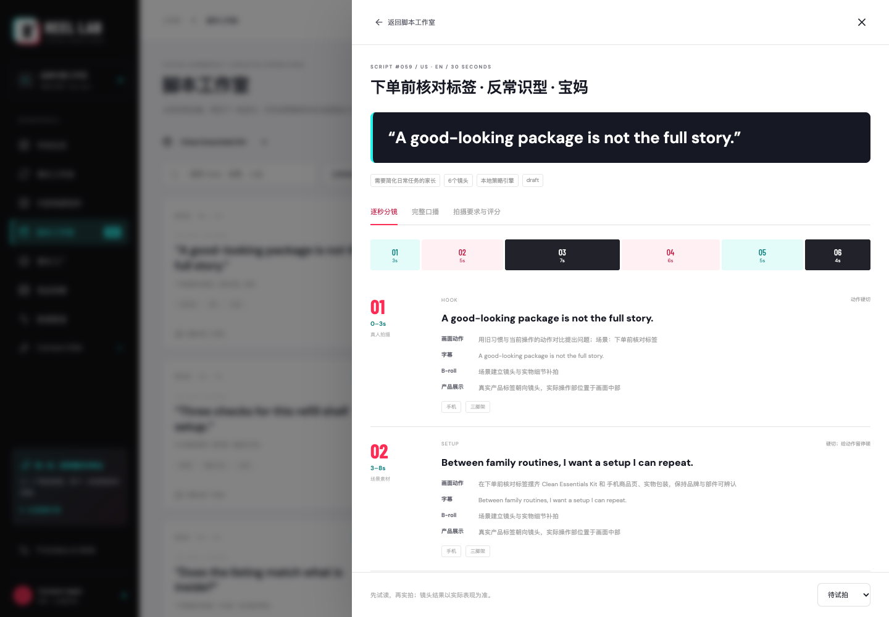

# REEL LAB · TikTok 短视频带货智能体使用说明

**作者：越哥｜全网同名：越哥聊AI。非商业使用允许，无须另行申请；商业使用须事先获得作者明确书面授权。** 详见 [自定义授权协议](LICENSE)。

适用版本：本机单团队 V1 · 2026-10-06。界面采用黑白、青色与玫红的 TikTok 风格配色。

## 1. 产品定位

REEL LAB 是一个面向带货内容团队的内容策划与迭代工作区。它把商品事实、评论洞察、视频参考结构、批量脚本、分镜、素材任务和效果复盘保存在同一个商品工作区，交付可以试读、拍摄和继续测试的内容方案。

核心路线：**商品链接 → 商品与评论研究 → 参考内容拆解 → 100 条脚本 → Top20 → 素材任务 → 导入表现 → Content DNA → 下一轮内容**。

当前可运行的是本机工作区。在线文本模型可选；TikTok 官方账户授权、自动视频生成、TTS、数字人、自动剪辑和发布尚未接入。无模型密钥时使用标明来源的本地策略引擎。

## 2. 适用人群与核心场景

| 人群 | 适合解决的日常问题 | 主要交付物 |
| --- | --- | --- |
| TikTok Shop 卖家 | 一个商品不知道如何拆成不同卖法 | 13 类内容角度、100 条试拍方案、Top20 |
| 跨境品牌 / DTC 团队 | 英文脚本、人设和素材需求难以统一 | 本地化试读稿、创作者要求、拍摄任务 |
| MCN / UGC 团队 | 同一商品要分配给不同创作者 | 大学生、宝妈、健身达人、测评博主人设脚本 |
| 投流 / 内容运营 | 历史内容数据无法反馈给下一批创作 | 同口径复盘、Content DNA、第二轮内容 |
| 培训讲师 / 售前团队 | 需要展示从输入到结果的完整案例 | 工作流页面、真实截图、演示输入和输出包 |

新品冷启动可先生成 100 条候选，再选 Top20 小批量试拍。素材复用场景可先看 Shot List；复盘场景应先整理自有视频级数据再导入。

## 3. 首次启动与演示入口

要求 Node.js 22.13 或更新版本。在项目根目录执行：

```bash
npm ci
npm run dev
```

打开 `http://127.0.0.1:4348/`。

- 工作区为空：点击“运行真实商品 Demo”。
- 已有商品：进入“增长工作流”，点击“从真实链接运行 Demo”。
- 网络不稳定：点击“用来源快照演示”，或到“Providers & Skills”点击“载入已取证的 Demo 快照”。这会读取带来源时间的已存档商品资料。
- 两种 Demo 都新建独立商品工作区，生成两轮各 100 条内容，并导入 **30 条模拟历史表现**。它们不会覆盖已有商品。
- 商品或批次不对时，使用页面顶部“切换商品”“切换批次”下拉框。最新商品会在刷新后默认选中。

终端也可复演：`npm run demo` 使用快照；`npm run demo -- --live` 重新研究公开商品。终端 Demo 不创建界面 Job 记录，因此工作流的“真实执行记录”可能为空，但批次产物仍可查看。

## 4. 支持哪些输入

| 输入 | 界面入口 | 格式与约束 |
| --- | --- | --- |
| 商品链接 | 新建商品 → 商品链接 | Shopify、独立站公开结构化页面；TikTok Shop / Amazon 受限时用授权来源或 JSON |
| 商品资料 | 新建商品 → 商品 JSON 导入 | name、url、sellingPoints 必填；可附价格、图片、FAQ、规格、评论 |
| 视频参考 | 竞品拆解 → 导入参考视频 | 单个带时间戳镜头标注 JSON，或授权 Provider 视频 URL |
| 批量要求 | 生成新一轮内容 | 数量 1–100；15 / 30 / 60 秒；市场、语言、人设、生产方式 |
| 视频表现 | 数据复盘 → 导入视频数据 | CSV / JSON 数组，单文件不超过 5 MB；先选择真实或模拟来源 |
| 自然语言 | 页底“告诉智能体，下一步做什么” | 支持下表中的有限类型命令，不是任意对话接口 |

商品导入模板见 [examples/product-import.json](examples/product-import.json)。示例为教学商品，不宣称来自真实品牌。

视频标注模板见 [examples/reference-annotation.json](examples/reference-annotation.json)。教学参考采用模拟标识；真实使用时填写你有权使用的来源及观察到的内容。只有 URL 且没有授权解析 Provider 时，系统不会猜测画面和业绩。`annotated` 表示含人工镜头标注，`transcript` 表示仅转录；未知视觉信息应留空。

## 5. 从商品到可拍内容：操作步骤

### 第一步：研究商品

点击“新建商品”，输入商品链接，选择“公开结构化商品页”，再点击“研究商品”。任务状态显示在页面顶部。成功后，在首页打开“查看商品洞察”，核对商品价格、卖点、FAQ、评论样本和来源。

商品信息缺失时补充 JSON 或授权 Provider。评论中的相关单品样本与当前商品样本分开显示，不要将关联商品评论误读为当前 SKU 的评价。

### 第二步：积累参考结构

进入“竞品拆解”，导入逐镜头标注或转录。系统整理前 3 秒、镜头节奏、字幕结构、卖点顺序、情绪、CTA 和评论反馈，形成 Content Pattern。生成内容时借鉴结构，不直接复用竞品口播和素材。

Demo 包含 1 条实际观察的品牌公开视频参考标注和 2 条模拟竞品结构。品牌参考并非独立竞品，也没有可证明其是爆款的业务数据。

### 第三步：生成第一轮

点击“生成新一轮内容”，建议首次使用：100 条、30 秒、美国、English、混合人设、本地策略引擎。点击“生成 100 条可拍脚本”。

“内容角度矩阵”展示痛点、效果展示、前后对比、测评、开箱、教程、场景、用户故事、价格价值、反常识、FAQ、挑战、UGC 口碑等 13 类角度。点击单元格可以筛选脚本。

本地清洁套装 Demo 有专门的拍摄方案；其他商品采用通用实物验证框架。通用模板仅支持中英文；其他语言建议接入模型。国家、人群和文化适配是创作假设，仍需当地人员审稿。

### 第四步：选择 Top20 并试读

首页点击“查看 Top20”，或在“脚本工作室”启用“仅 Top20”。打开任意脚本，查看三个页签：

1. **逐秒分镜**：每镜头时长、口播、动作、字幕、B-roll、产品展示、转场和设备。
2. **完整口播**：可复制口播、CTA 和音乐建议。
3. **拍摄要求与评分**：Hook 强度、信息密度、拍摄易度、素材成本、产品清晰度、差异化、平台适配，以及拍摄要求。

七维分数是规则评分，用于排定试拍顺序，不是爆款概率、播放量或 GMV 预测。先试读并验证镜头可实现，再将脚本状态从“待试拍”改为“准备拍摄”；实际完成后才标记“已拍摄”。

### 第五步：分配素材与拍摄任务

进入“素材工厂”，查看真人拍摄、产品特写、场景等需求。点击“管理”填写负责人、状态、素材链接、使用权。同类素材可被多条脚本复用。

“素材可用”要求提供有效 HTTP(S) 链接且确认自有或已获授权；系统不托管上传的视频文件。点击“导出 Shot List”交给拍摄团队。

### 第六步：导入历史表现

进入“数据复盘”，点击“导入视频数据”。真实业务选“真实业务数据 · 用户导入”；教学样本必须选“模拟数据 · 仅验证流程”。粘贴 CSV / JSON 或选择文件，再点“校验并导入数据”。

基础字段：`externalId`、`publishedAt`（ISO UTC）、`currency`、`market`、`language`、`views`。可用本地 `scriptId` 关联脚本；若没有对应脚本，必须提供完整 `dna`，才能按内容标签复盘。关联脚本时以存档 DNA 为准。

可选指标：`retention3s`、`completionRate`、`avgWatchSeconds`、`clicks`、`ctr`、`orders`、`cvr`、`gmv`、`spend`、`roas`。未知留空或 null，不能用零代替未知。JSON 比例用 0–1，CSV 也接受 `75%`。计数已知时会重算并核对比率。

同商品、同来源和相同 externalId 的导入会更新原记录，不重复累计；一行校验失败时整批不保存。无脚本依赖的教学样例见 [examples/performance-synthetic.json](examples/performance-synthetic.json)；完整 Demo 对应的 30 条样本见 [outputs/history-synthetic.json](outputs/history-synthetic.json)，只适用于其关联的 Demo 商品。

### 第七步：复盘后生成第二轮

选择数据组（来源、市场、语言、币种），点击“复盘最近30条”。这里指按发布时间排序的最近 30 条视频，不是最近 30 天。不同币种和模拟 / 真实来源不能混用。

查看 Content DNA 中的 Hook、结构、时长、人设、场景、卖点和 CTA 标签。每组至少 3 条，按播放量加权计算千次播放 GMV，并平滑小样本。结果是观察关联，不能解释为因果。

点击“生成下一轮 100 条”。系统用复盘结果调整约 70% 候选方向，保留约 30% 探索，并避免历史完整组合重复。在“增长工作流”查看新批次、依据和导出入口。实拍、投放及新的业务数据仍由团队完成。

### 第八步：交付与导出

- 顶部“导出工作包”：当前批次完整 JSON，包括商品、脚本、分镜、素材。
- 脚本工作室“导出脚本”：全部或 Top20 Markdown；角度 / 搜索筛选不会改变导出集合，只由 Top20 开关控制。
- 素材工厂“导出 Shot List”：全部素材任务 CSV。
- 增长工作流：可直接导出每一批的 Top20。

## 6. 自然语言指令

| 示例 | 当前行为 |
| --- | --- |
| 给这个商品生成100条美国市场脚本 | 在当前商品下新建 100 条批次；语言和时长默认沿用当前批次，需明确英文可加“英文” |
| 只做15秒UGC | 默认生成 20 条 15 秒 UGC 方案；不是 100 条 |
| 把Top10改成宝妈人设 | 对当前批次 Top10 改写人设，保存父脚本关系 |
| 根据最近30条视频数据重新生成下一批 | 使用该商品、市场、语言最近已保存的复盘生成内容；先在数据复盘页完成“复盘最近30条” |

若提示没有复盘，先导入数据并运行对应市场和语言的复盘。复杂自由对话不会自动执行；明确数量、市场、语言、时长和人设更容易得到预期结果。

## 7. 输出示例与阅读方法

本次实际运行的完整 Top20 和分镜在 [outputs/round-1-top20.md](outputs/round-1-top20.md)，优化后结果在 [outputs/round-2-top20.md](outputs/round-2-top20.md)。单条完整示例在 [输出示例.md](输出示例.md)。

每条脚本应检查：目标用户 → 内容角度 → 前三秒 Hook → 完整口播 → 逐镜头时长和动作 → 字幕 → B-roll → 产品展示 → 音乐 → CTA → 总时长 → 评分与风险提示。直接交付团队时使用完整工作包，不要只截 Hook。



## 8. Provider 配置

“Providers & Skills”页显示当前能力状态。配置文件在项目根目录，将 `.env.example` 复制为 `.env` 后填写并重启服务：

```dotenv
AI_BASE_URL=https://api.openai.com/v1
AI_API_KEY=填写你自己的密钥
AI_MODEL=填写你的模型名称
DATA_PROVIDER_URL=你的授权数据网关
DATA_PROVIDER_TOKEN=你的网关令牌
```

无需模型即可跑 Demo。使用模型时，在“生成新一轮内容”选择“兼容模型”。模型失败或结构不合格会显示错误、整批不落库，不会悄悄退回模板。在线模型质量、费用和延迟需在你的配置下另行验证。

授权网关须遵循项目 `docs/PROVIDERS.md` 中的统一接口；填入地址不等于已获得 TikTok 或 Amazon 授权。模型密钥仅在服务器配置，截图和对外案例不要包含 `.env` 内容。

## 9. 注意事项与常见问题

| 情况 | 处理方式 |
| --- | --- |
| 链接被限制或没有结构化商品信息 | 改用官方授权数据或商品 JSON；不要把读取失败当成研究成功 |
| Demo 网络失败 | 查看任务错误，使用“用来源快照演示”；对外说明是历史快照 |
| 评论数量多，但当前商品样本少 | 按 scope 阅读；关联单品只能提供方向性参考 |
| Top20 数量少于 20 | 当前批次小于 20 条时，Top 集合不超过批次总量 |
| 无法继续生成大量内容 | 现有角度 / 场景 / 人设组合可能耗尽，调整需求或补充策略，不要重复无限点生成 |
| CSV 导入失败 | 检查数字、日期、比例、scriptId、完整 DNA 和点击 / 订单关系；错误修复后整批重试 |
| 没有 DNA 规律 | 可能样本不足、指标缺失或标签无可比较变化；积累同口径数据再分析 |
| 手机界面某些侧栏只剩图标 | 这是响应式布局；桌面端更适合批量查看矩阵与表格 |
| 重启后任务失败 | 重启会将未完成任务标为中断；重新发起，不会显示虚假完成 |

不编造产品功效、价格优惠、用户体验、前后对比或评论。人设是创作视角，不应冒充真实消费者证言。音乐和素材需确认商用权；竞品只借鉴结构。商品图片及品牌标识属于原权利人，Demo 不代表品牌委托、客户背书或合作授权。

案例中的 GMV、ROAS 与高表现标签来自模拟样本。它证明流程和分配机制可运行，不能证明已经帮助品牌增长或提高投放 ROI。

## 10. 数据保存与复演

数据保存在 `data/studio.sqlite`，重启保留。备份前停服务并复制整个 `data` 目录，以保留可能存在的 WAL 文件。默认只监听 `127.0.0.1`，不包含多租户、权限管理和公网安全部署。

修改代码后可运行 `npm run build`、`npm test`。截图复演见 [采集说明.md](采集说明.md)。案例素材索引见 [README.md](README.md)，对外简版见 [案例说明.md](案例说明.md)。
